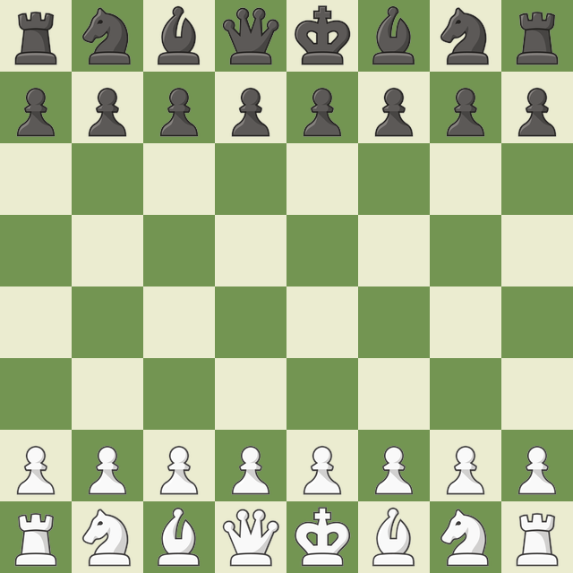

# chess.com-boards-and-pieces

This repository contains boards and sets of pieces from <strong>[chess.com](https://www.chess.com)</strong>.
</br>
Checkout `default-config.json` for details.
</br>
Checkout `boards/` and `pieces/` directories to see available images of boards and pieces.


<!-- BOARD -->
<p align="center">
    
</p>
<p align="center">
    <code>uv run python render_position.py --pieces ejgfv --board 9rdwe</code>
</p>
<!-- BOARD -->


## Initialize the Project

```shell
uv sync # Download packages
```


## Downloading Boards and Pieces

To download boards and pieces from <strong>[chess.com](https://www.chess.com)</strong>, run:

```shell
python fetcher.py
# or
python fetcher.py -c/--config <CONFIG-FILE> -o/--output <OUTPUT-DIR>
```


## Chess Position Renderer

The `render_position.py` script generates chess position images by combining board and piece PNGs based on a FEN string. It supports:

- Custom board styles and piece sets from the repository
- FEN notation input (including loading positions from `fen.json` by ID)
- Configurable square sizes
- Rendering from either player's perspective (white or black)
- Custom output filenames

### Usage

```
Usage: render_position.py [OPTIONS]

  Render chess positions from FEN notation using chess.com board and piece
  images.

  Examples:
  * Starting position with brown board and alpha pieces:
      uv run render_position.py --board brown --pieces alpha --size 80
  * Custom position:
      uv run render_position.py --fen "r1bqkb1r/pppp1ppp/2n2n2/4p3/2B1P3/5N2/PPPP1PPP/RNBQK2R w KQkq - 4 4" --board marble --pieces 3d_wood --size 100

Options:
  --fen TEXT            FEN string representing the chess position (default:
                        starting position if neither --fen nor --id provided)
  --id INTEGER          Load FEN from fen.json by position ID
  --board TEXT          Board style name without .png extension (e.g.,
                        "brown", "marble")  [required]
  --pieces TEXT         Pieces directory name (e.g., "alpha", "3d_wood")
                        [required]
  --size INTEGER        Size of each square in pixels  [default: 80]
  --side [white|black]  Perspective to render from: white (bottom) or black
                        (top)  [default: white]
  --output PATH         Output filename  [default: chess_position.png]
  -h, --help            Show this message and exit.
```

## Development

Format the Python source code after making changes:

```shell
.script/format(.ps1/.sh)
```
